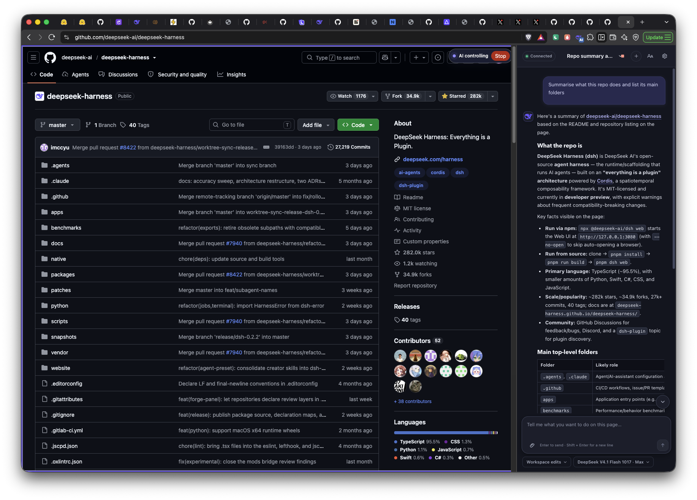

# dsh-browser-agent

[](https://github.com/natgurlain/dsh-browser-agent/releases)
[](https://www.npmjs.com/package/dsh-browser-agent)
[](LICENSE)


[](docs/dsh-matrix.md)

**English** | [中文](README.zh.md)

Let [DeepSeek Harness](https://github.com/deepseek-ai/deepseek-harness) (DSH) work in the browser you already use. The agent reads the page you are on, clicks, types, navigates and manages tabs, in your own Chrome, Brave or Firefox (other Chromium browsers should work too), with your logins and cookies, and you watch and approve what it does from a side panel.



> Based on [dsh-browser](https://github.com/omdsh-dev/dsh-browser) by Yuxiang Lin and contributors (MIT). See [NOTICE](NOTICE).

**Contents:** [What it is](#what-it-is) · [Why this one](#why-this-one) · [Quick start](#quick-start) · [Install from a release](#install-from-a-release) · [Core capabilities](#core-capabilities) · [Detailed installation and usage](#detailed-installation-and-usage) · [Troubleshooting](#troubleshooting) · [Development](#development) · [Security](#security)

## What it is

Two parts that ship together in this repository:

- **A browser extension** (Manifest V3) with a side panel for the conversation. It turns the page into structured text with a numbered list of everything you can interact with, and carries out the agent's actions in the real tab.
- **A DSH plugin** (the "bridge") that gives DSH the `browser_*` tools and talks to the extension over a local, authenticated connection.

It works with the DeepSeek Harness desktop app and with `dsh web`, uses whatever models you have configured there, and can also be driven from Claude Code, Cursor or Codex through MCP.

## Why this one

- **Your real browser, not a robot browser.** No separate profile, no re-login, no headless window: the agent works in the tab you are looking at.
- **You stay in charge.** Actions that change something show an approval card with exactly what will be clicked, typed or opened. You can pause, take over the page, or hit Stop, which cuts everything off at once.
- **Built for hostile pages.** Once the agent has read a web page, sending data to another site, the clipboard or a file asks first, and shell and file tools are switched off for that conversation, so a page that tries to hijack the agent has nowhere to send what it finds. Banking, password and cloud-console sites are read-only by default.
- **A locked front door.** The extension and DSH prove themselves to each other on every connection with a shared secret that never crosses the wire; other programs and other extensions on your machine cannot connect.
- **A record of everything.** Every action, approval and stop is written to a tamper-evident audit log you can export.
- **More than clicking.** Tables to CSV, PDFs, downloads, file uploads, hover and drag, dialogs, parallel reading across tabs, page watchers, and saved workflows you can replay or schedule.
- **Comfortable to use.** Light and dark themes, English and Chinese, adjustable text size.

## Quick start

You need DeepSeek Harness (the desktop app, or `dsh` 0.2.2-rc.1 to rc.3) and a Chromium browser or Firefox.

```sh
git clone https://github.com/natgurlain/dsh-browser-agent.git
cd dsh-browser-agent
./scripts/install.sh
```

The installer builds the extension and the plugin, registers the plugin with the DeepSeek Harness desktop app and with the `web` profile, and opens your browser's extensions page. It uses a Node.js 24.9+ and pnpm that are already on your machine, including the ones bundled with the desktop app, and tells you what to install if it finds none. Then:

1. On the extensions page, turn on **Developer mode**, click **Load unpacked** and choose `~/.dsh/browser-extension` (first time only; after an update, click **Reload**).
2. Open DeepSeek Harness (restart it if it was running).
3. Open any web page, click the whale icon in the toolbar and wait for **Connected**.

No address or password to enter: the installer gives the extension what it needs to find and authenticate to DSH on your machine.

> [!NOTE]
> Status: early. macOS and Linux installs are exercised regularly; the Windows installer (`scripts/install.ps1`) exists but has not been run on a Windows machine yet. Supported DSH releases are listed in [docs/dsh-matrix.md](docs/dsh-matrix.md); on 0.2.2-rc.1, Continue after a failed turn and the wait for worktree cleanup on delete are unavailable.

## Install from a release

The installer installs the bridge plugin and Chrome extension. It downloads one tagged release, checks every downloaded file against that release's `SHA256SUMS`, and only then unpacks it and builds it from source. A digest mismatch, a missing `SHA256SUMS` or an incomplete download stops the install before anything is unpacked or run.

macOS and Linux. Download the installer, check it against the published digest, then run it:

```sh
tag=v0.3.2
base=https://github.com/natgurlain/dsh-browser-agent/releases/download/$tag
curl --proto '=https' --tlsv1.2 -fsSL -O "$base/install.sh" -O "$base/SHA256SUMS"
grep ' install.sh$' SHA256SUMS | sha256sum -c -    # macOS: shasum -a 256 -c -
bash install.sh --release "$tag"
```

Windows, in PowerShell (the release path of `install.ps1` has not been run on a Windows machine yet):

```powershell
$tag = 'v0.3.2'
$base = "https://github.com/natgurlain/dsh-browser-agent/releases/download/$tag"
irm "$base/install.ps1" -OutFile install.ps1; irm "$base/SHA256SUMS" -OutFile SHA256SUMS
$want = (Select-String -Path SHA256SUMS -Pattern ' install\.ps1$').Line.Split(' ')[0]
if ((Get-FileHash install.ps1 -Algorithm SHA256).Hash -ne $want) { throw 'install.ps1 does not match SHA256SUMS' }
powershell -NoProfile -ExecutionPolicy Bypass -File .\install.ps1 --release $tag
```

The same digests are printed in the notes of each [release](https://github.com/natgurlain/dsh-browser-agent/releases). The shorter form below runs the installer without checking the script first; what the installer downloads is still verified:

```sh
curl --proto '=https' --tlsv1.2 -fsSL https://github.com/natgurlain/dsh-browser-agent/releases/download/v0.3.2/install.sh | bash -s -- --release v0.3.2
```

`--release latest` installs the newest release instead of a named one. `SHA256SUMS` comes from the same release as the files, so it catches a corrupted, truncated or substituted download, not a release that was itself published by someone who took over the repository or its release workflow; see [RELEASING.md](RELEASING.md#what-verification-covers).

When the installer opens `chrome://extensions`, follow its instructions to load or reload the extension, which the browser lists as **dsh Browser Agent**. If dsh is already running, restart it after installation. See [Detailed installation and usage](#detailed-installation-and-usage) for prerequisites, startup commands, updates, and developer installation.

> [!IMPORTANT]
> The unscoped [`dsh-browser`](https://www.npmjs.com/package/dsh-browser) package on npm belongs to a different project and is not affiliated with this repository. This project's npm package is [`dsh-browser-agent`](https://www.npmjs.com/package/dsh-browser-agent); it holds the plugin only, so use the installer above to get the extension too.

### Plugin only, without the installer

If you would rather add the plugin with DSH's own plugin command, each release also carries the plugin package and the extension builds on their own:

```sh
dsh plugin --profile web add https://github.com/natgurlain/dsh-browser-agent/releases/download/v0.3.2/dsh-browser-agent-plugin-v0.3.2.tgz
```

The plugin package is `dsh-browser-agent` since v0.3.1; it was `@natgurlain/dsh-bridge-browser` before. If you added an earlier release this way, remove the old package first, since both would register the same bridge: `dsh plugin --profile web remove @natgurlain/dsh-bridge-browser`. Settings you saved for the old package are carried over by `node scripts/migrate-bridge-name.mjs ~/.dsh web` from a checkout (the installer does this for you); otherwise save them again in DSH's plugin settings.

Then download `dsh-browser-chrome-v0.3.2.zip` (or the Firefox zip) from the same [release](https://github.com/natgurlain/dsh-browser-agent/releases), unzip it, load it with **Load unpacked** on your browser's extensions page, and open the side panel. An extension installed this way has no token yet: it shows a short code, and typing that code into the card that appears in DSH connects the two. For the DeepSeek Harness desktop app, use the installer above: it registers the plugin with the app for you.

## Core capabilities

| Capability | Tool | Notes |
|---|---|---|
| Read page | `browser_snapshot` | Structured text snapshot: title, URL, main text, numbered controls, and masked form fields; `delta: true` returns only changes, `frame` reads one iframe, and `query` locates any element by text/selector/role and returns its selector |
| Click | `browser_click` | Click or double-click by index or selector; supports mouse buttons and modifiers |
| Text | `browser_type` | React/Vue-compatible input; `replace` clears the field first, and `mode` selects caret insertion or per-character key events |
| Press keys | `browser_press` | Single keys or chords (`modifiers`); `action: down/up` holds a key across calls and `repeat` repeats it |
| Scroll | `browser_scroll` | Scroll the page or selected iframe up, down, to the top, or to the bottom |
| Clipboard | `browser_clipboard` | `write` puts text/HTML on the system clipboard; `paste` delivers it as a paste event or a real platform shortcut |
| Files | `browser_upload` | Attach local files to an `input[type=file]` (Chrome) |
| Navigate | `browser_navigate` / `browser_open_tab` / `browser_back` / `browser_forward` / `browser_reload` | Navigation inside the controlled tab, or open a URL in a new tab and follow it (`active:false` keeps the current tab in front) |
| List tabs | `browser_list_tabs` | List accessible tabs with stable IDs, titles, URLs, window/index metadata, and active/controlled state |
| Follow tab | `browser_follow_tab` | Bind later browser tools to a tab returned by `browser_list_tabs`; it stays in the background unless `activate: true` |
| Close tab | `browser_close_tab` | Close a tab returned by `browser_list_tabs` |
| Hover / drag | `browser_hover` / `browser_drag` | Move the real pointer over an element (hover menus); drag to an element or by an offset, with HTML5 drag-and-drop for draggable sources |
| Dialogs | `browser_dialog` | Answer an alert/confirm/prompt/leave-site dialog; calls blocked by an open dialog fail fast with `dialog open: …` (Chrome) |
| Downloads | `browser_downloads` | List recent downloads or wait for one; returns local file paths. Asks for the optional `downloads` permission on first use |
| PDF | `browser_save_pdf` / `browser_pdf_text` | Save the tab as a PDF in the agent workspace (Chrome); extract the text of a PDF open in the tab |
| Choose options | `browser_select` | Pick options in a `<select>`, ARIA listbox or combobox by value, label or index |
| Extract tables | `browser_extract` | Rows from a table or repeated elements (schema), optionally across pages; `saveTo` writes CSV/JSON to the session workspace |
| Batch actions | `browser_run` | Up to 25 browser actions in order behind one approval card; stops at the first error or failed `expect` |
| Watch a page | `browser_watch` / `browser_watches` | Wake this session when a selector or text appears or disappears, the URL matches, or a request is seen; list or cancel watchers. Off until enabled in settings, and each watcher is approved |
| Read many pages | `browser_fanout` | Up to 8 subagents, each with its own background tab, read in parallel (read-only unless `allowActions`) and return structured answers |
| Delegate | `delegate_browser_task` | A regular DSH session hands page work to the browser subagent, so snapshots stay out of its conversation |
| Saved workflows | `browser_workflow_list` / `browser_workflow_run` | List and replay workflows saved from earlier runs (see [Learning features](#learning-features-experimental-all-off-by-default)) |
| Read region | `browser_get_text` | Lazy-loaded or partial page text |
| Wait for stability | `browser_wait` | Page-load and render-settle detection |
| Send images | `session.prompt` / `session.attachment` | Host-capability-gated image drafts, image-only prompts, and durable history previews |
| Quote a selection | side panel composer | Text you highlight in the page appears in the composer and is sent with your next message as fenced, attributed page content |
| Continue generating | side panel | Continue an interrupted response when the host offers it |

Clicks, text entry, and scrolling run in the selected document, including cross-origin iframes. Chrome uses its debugger for native keyboard events, caret insertion, system paste, and file uploads. Screenshots require an active tab in a focused window; `browser_follow_tab { activate: true }` brings the controlled page to the front.

Before every click the target's center is hit-tested; a target covered by another element is refused with `covered by <element>` instead of clicking what lies on top. `browser_click { trusted: true }` clicks with real mouse input (Chrome), and a plain click on a custom element that visibly changed nothing is retried that way once. The **stop button** in the side panel (or Ctrl+Shift+K / ⌘⇧K; Alt+Shift+K in Firefox; rebindable on the browser's extension shortcuts page) cancels pending approvals and running actions, revokes session trust and developer-tools grants, turns unrestricted access off, detaches the debugger, and disconnects until you press Reconnect. Tabs the agent controls show an **AI** badge.

### Visibility and control

- **Approval cards** show exactly what will be clicked, typed or opened before it happens, and each card is bound to that one action.
- **Pause / take over.** *Pause after this step* lets the current action finish and holds the next one until you resume. *Take over* pauses the agent so you can use the page yourself; resume hands control back, and the model is told what changed.
- **Agent overlay.** A ghost cursor and outline mark each target before the agent acts, and while a turn is acting on a tab, the tab gets a colored frame with a Stop button; an idle tab shows nothing (Settings can turn the overlay off).
- **Step timeline and audit log.** The side panel lists each step of a run. Every action, approval and kill-switch engagement is written to a tamper-evident audit log under `~/.dsh/browser-audit/`, which you can export from Settings.
- **Site rules.** In Settings, mark a site as blocked, read-only, always ask or trusted. After the agent reads untrusted content, writes to other sites need a fresh approval (taint rules). Your own local pages and sites you marked trusted do not count as untrusted content; see [Security](#security).
- **Strict mode** (Chrome). For sites you list, or for one agent session, the page's outgoing writes are held at the network layer until you approve them.

### Auto approve

Like DeepSeek Harness's own auto-approve: switch it on and the agent works without asking. Click **Auto approve** under the message box; the first time, one confirmation states the trade-off. It stays on for that conversation (also after a restart) until you click it again or **Turn off**. Settings → Permissions & safety → *Start conversations in Auto approve* makes it the default (off unless you turn it on).

- **Ordinary steps run at once**: no card, no extra model call, no wait. Navigating, clicking, typing, choosing, searching, reading pages and opening tabs all count as ordinary.
- **Consequential steps are checked silently** by this conversation's model first: buttons, links and forms that send, delete, submit (POST), publish, share, unsubscribe, transfer, pay or buy; password and payment fields; uploads, downloads and file writes; programs, watchers; and the steps the taint rules flag after the agent read untrusted web pages (typing into another site, a URL carrying data, the clipboard). The timeline shows *Checking…*; if the check allows it, it runs with no card. If it objects, times out (8 s) or fails, you get the usual card with the reviewer's one-line reason.
- **What still asks**: the developer-tools allowance, the first download (Chrome's permission needs your click), sites you set to *Always ask*, strict mode, and conversations of other apps (MCP).
- **The trade-off**: with Auto approve on, the agent acts without asking; a web page that tricks the model can make it do things you did not ask for. The check sees only your messages, the action, the control's label and the page address, never the page's content, and treats page text as data; a page that fools the agent may still fool it. Turn it off, or set a site to *Always ask*, where that matters. The kill switch stops everything at once, as always.
- **Record**: every step it passed is marked **Auto** in the timeline ("Auto-approved", or "Auto-approved after a check" with the reviewer's note in the details) and in the audit log. Each check is one extra request to this conversation's model through DSH, on your account.
- Administrators: managed policy `disableAutoReview`; the bridge plugin config `autoReview: false` removes the check (consequential steps then ask). Design: [docs/auto-approve-design.md](docs/auto-approve-design.md).

### Use the browser from Claude Code, Cursor or Codex (MCP)

Set `mcp: { enabled: true }` in the `bridge-browser` plugin config. Then register the stdio shim `packages/browser/mcp-server/bin/dsh-browser-mcp.mjs` with your MCP client, for example `claude mcp add dsh-browser -- node /abs/path/to/dsh-browser-mcp.mjs`. Every MCP call goes through the same approval cards, site policy, taint rules, kill switch and audit log as DSH's own sessions. Each card names the MCP client that is asking. Setup snippets for Cursor and Codex are in [packages/browser/mcp-server/README.md](packages/browser/mcp-server/README.md).

### Learning features (experimental, all off by default)

Turn them on in the side panel under **Settings → Learning (experimental)**. Every replayed or learned action still passes the pause gate, site policy, taint rules, kill switch, approval cards and audit log.

- **Save as workflow.** With "Record runs" on, the agent's successful steps are kept in memory together with how to find each element again: role, accessible name, text, and a CSS fallback. **Save as workflow** writes them to `browser-workflows/<name>.workflow.json` in the session workspace. You choose which typed values become parameters. Values typed into sensitive fields are never stored; they become required parameters instead. Each saved workflow is also offered as a DSH skill.
  - `browser_workflow_run` replays a workflow and looks up every element fresh. When the element is gone or ambiguous it stops and hands the step to the model.
  - The panel can schedule a workflow to run in its own conversation, at most once per minute. Its approval cards still ask and fail closed when nobody answers. Workflows with sensitive inputs cannot be scheduled.

**Connection with the side panel closed.** After the last panel closes, the extension keeps its connection for 5 minutes past the last tool call or approval, then disconnects and lets its background worker sleep. Three opt-in features are meant to run unattended, so while one of them is in use the connection stays up and comes back by itself: live page watchers, workflow schedules created from this browser, and the MCP endpoint (`mcp.enabled`). dsh tells the extension about the last two when it connects; the extension remembers that, so after a browser restart it reconnects to the same address without a panel. It never scans for dsh on its own, and while dsh is unreachable it retries less and less often (30 s, doubling to at most 5 minutes). Settings shows what is keeping the browser connected. The stop button ends all of it: nothing reconnects until you press Reconnect. Approval cards that policy forces can still only be answered in the panel, so an unattended run that reaches one fails closed.
- **Watch me.** While watching, your own clicks and typing on the tab are recorded. Passwords are never recorded and sensitive fields are masked. After two repetitions over table or list rows, the panel offers **Do the remaining N like this**, which runs as a single `browser_run` program behind one card. Only rows that are visible and look like the ones you did (same kind of element, same label apart from the row's own text) are offered. Every step records what its element looks like and which row it sits in, and the action compares that with the very element it is about to click or type into; on any difference it stops before touching the row and says why ("Stopped after 20 of 38 rows. Row 21: it no longer looks like the rows you approved (was “1042 · Paid”, now “1043 · Paid”)"). Styling, a spinner, a control's own label elsewhere in the row, or changes elsewhere on the page do not stop it; a change to what the row itself says does. A remainder longer than one program (25 steps) runs in batches under one card, but only when the rows can be told apart: each must have an identity (its id or first text cell plus its first worded cell) and no two may share one. Otherwise the panel offers 25 steps at a time and says so. The series card states the total rows and steps and shows one line per row ("Click “Refund” — 1042 · Paid"; open a row for its exact steps); it is answered in the side panel only, and one run does at most 250 steps. The approval ends when the tab is reloaded or its URL changes at all (path, query or fragment), when anything else acts on the tab or in the session, when you take over, on the kill switch, and after 30 minutes; a step that was already waiting then asks on its own. A stopped run can be continued with one click: that looks at the page as it is then and asks again with a new card; a row the run left part-done is skipped and named on that card, for you to finish by hand. Pause holds the run between batches as well as before every step. What this does not do: the page owns its DOM, so a page built to deceive can keep a button's kind, label and row text while changing what the click does. These checks protect against an honest page changing underneath a run and against the agent doing more than you approved, not against a hostile page.
- **Site drivers** (Chrome only; developer tools must be allowed). For sites you list, the same-origin request behind an agent action is proposed as a typed tool (`browser_site_<host>_<name>`). Nothing is saved until you approve it, and cookies, tokens and sensitive fields are never stored: tokens are read from the page each time. Every use shows the exact request on its own card. If a driver fails, the agent goes back to the page UI. Drivers can be exported and imported as JSON.
- **Failure fixtures.** A failed step saves a sanitized copy of the page, with sensitive values masked and scripts removed, plus the intended action under `browser-fixtures/` in the session workspace. Pages that are blocked or not shared are skipped, and each save is recorded in the audit log. `node benchmark/import-fixtures.mjs <dir>` turns these files into benchmark task files. `benchmark/online-mind2web/` loads an Online-Mind2Web subset at runtime and renders a static leaderboard from results produced elsewhere. Neither has a runner yet: `benchmark/run.mjs` runs only the built-in tasks (see [benchmark/README.md](benchmark/README.md)).

## Detailed installation and usage

Requirements: Node.js `>=24.9.0`, Corepack/pnpm, and Chrome 125+ or Firefox 140+. Windows additionally needs Windows PowerShell 5.1, which ships with Windows, or PowerShell 7+.

### Install or update

Run the [release install commands](#install-from-a-release), or `./scripts/install.sh` from a checkout, to install. It is one command on macOS and Linux; the installer does the rest:

- **DeepSeek Harness desktop app.** When the app is installed (`/Applications` or `~/Applications` on macOS; `DSH_DESKTOP_APP=<path>` for another location, `DSH_DESKTOP_APP=none` to skip it), the bridge is registered with the app's own `desktop` profile through the CLI bundled in the app, in addition to the `web` profile. Quit and reopen the app afterwards. If the app's DSH version is outside the range the plugin supports, the installer says so, registers the `web` profile only, and asks you to update the app and run it again; it never overrides the version check.
- **Node.js and pnpm.** When `node` on PATH is missing or older than 24.9.0, the installer uses one that is already installed: the app's bundled Node, then a suitable version from asdf, nvm, fnm, volta or mise. When `pnpm` on PATH does not run, it uses the app's bundled pnpm, then Corepack, then `npx`. Nothing is installed for you; if no suitable Node exists, the installer prints the command for the tools it found.
- **Browser.** It opens the extensions page of the Chromium browser you have (Chrome, Chromium, Brave, Edge, Vivaldi or Arc; your default browser if it is one of them) and names that browser in its instructions. Load `~/.dsh/browser-extension` as an unpacked extension the first time, or click **Reload** after an update.

The summary at the end lists where the bridge was registered and what was skipped. `install.ps1` on Windows registers the `web` profile only and looks for Chrome or Chromium only. Restart dsh if it is already running.

To update, open **Settings → About** in the side panel. The check compares the running version with the latest GitHub release and offers a command that installs exactly that release with the installer already on disk, for example:

```sh
DSH_HOME="$HOME/.dsh" bash "$HOME/.dsh/dsh-browser/scripts/install.sh" --release v0.3.2
```

Installer options:

| Option | Environment | Effect |
| --- | --- | --- |
| `--release latest` or `--release vX.Y.Z` | `DSH_BROWSER_VERSION` | Download that tagged release and verify it against its `SHA256SUMS`. This is the default when the installer is not run from a checkout. |
| `--unverified-branch <name>` | `DSH_BROWSER_UNVERIFIED_BRANCH` | Development only: install a branch archive. A branch has no checksum, so nothing is verified. |
| | `DSH_BROWSER_GITHUB_TOKEN` | Token for a private repository. It is sent to `api.github.com` only and never printed. Without it the installer falls back to an authenticated `gh`. |
| | `DSH_BROWSER_NO_LAUNCH=1` | Do not open the browser or touch the clipboard. |
| | `DSH_DESKTOP_APP=<path>` or `none` | Where the DeepSeek Harness desktop app is, or `none` to leave it alone (`install.sh` and the uninstaller). |
| `--lang en` or `--lang zh` | `DSH_BROWSER_LANG` | Language of the installer and uninstaller output. One language is printed per run: English by default, Chinese when the system locale is Chinese. |

To install from a source checkout instead (nothing is downloaded):

```sh
git clone https://github.com/natgurlain/dsh-browser-agent.git
cd dsh-browser-agent
./scripts/install.sh
```

On Windows, run `.\scripts\install.ps1` from the checkout instead. After pulling or switching revisions, rerun the installer and reload the extension.

### Uninstall

Open **Settings → Uninstall dsh-browser** in the extension, copy the command, and run it in Terminal.

An installation that recorded its location is removed by the uninstaller it has on disk. Otherwise the command fetches the uninstaller published with the extension's own release; it downloads `uninstall.mjs` from that release and runs it only after its SHA-256 matched `SHA256SUMS`. On macOS or Linux:

```sh
curl --proto '=https' --tlsv1.2 -fsSL https://github.com/natgurlain/dsh-browser-agent/releases/download/v0.3.2/uninstall.sh | bash -s -- --release v0.3.2
```

On Windows:

```powershell
& { $ErrorActionPreference = 'Stop'; $d=New-Item -ItemType Directory -Path (Join-Path ([IO.Path]::GetTempPath()) ('dsh-browser-uninstall.'+[Guid]::NewGuid().ToString('N'))); try { $s=Join-Path $d.FullName 'uninstall.ps1'; Invoke-WebRequest -UseBasicParsing https://github.com/natgurlain/dsh-browser-agent/releases/download/v0.3.2/uninstall.ps1 -OutFile $s; powershell -NoProfile -ExecutionPolicy Bypass -File $s --release v0.3.2 } finally { Remove-Item -LiteralPath $d.FullName -Recurse -Force } }
```

From a checkout, run `bash scripts/uninstall.sh` or `.\scripts\uninstall.ps1`.

The uninstaller also removes the bridge from the desktop app's `desktop` profile, through the CLI bundled in the app (`--desktop-app <path>` or `DSH_DESKTOP_APP` when the app is not in `/Applications` or `~/Applications`). If the app cannot be found, that registration and the files it shares stay in place and the uninstaller says so.

### Firefox source build

Firefox uses a separate MV3 manifest, event-page background, and sidebar. Build it from a checkout, then open `about:debugging#/runtime/this-firefox`, choose **Load Temporary Add-on**, and select `extensions/dsh-browser/dist-firefox/manifest.json`:

```sh
pnpm install
pnpm --filter dsh-browser-extension run build:firefox
```

The bridge address is still auto-discovered. Firefox add-ons are not installed by the installer: open the side panel, and type the code it shows into the card that appears in DSH (see [docs/store/README.md](docs/store/README.md#pairing-a-store-installed-extension)). Pasting the bridge token from `~/.dsh/ext-bridge-token` into the extension settings still works as a fallback. Signed distribution can package the same `dist-firefox/` output.

### Start and use

With the DeepSeek Harness desktop app, open the app (restart it after installing). `pnpm start` and `dsh web` below start the separate `web` profile, which has none of the models configured in the app.

Start the managed installation with:

```sh
cd ~/.dsh/dsh-browser && pnpm start
```

From a source checkout, run `pnpm start` in the repository root. The default tested public runtime is:

```sh
npx @deepseek-ai/dsh@0.2.2-rc.2 web
```

Local Chrome use requires no configuration: the installer places the bridge token in the installed extension directory, and the plugin keeps that copy current. Firefox connects by pairing (the panel shows a short code to type into DSH) or with the local bridge token described above. Open a page, click the DeepSeek whale icon, and wait for **Connected**. Existing HTTP(S) tabs are instrumented on the first action. On browser-protected pages and extension stores, the model can read tab metadata and use browser-level HTTP(S) navigation, back, forward, and reload, but it cannot inspect or operate the protected page DOM.

## Troubleshooting

**Side panel stays "Not connected"**

- Make sure DSH is running. After installing or updating, restart DSH and reopen the side panel.
- Open **Settings → Detect** and select your DSH instance.
- A Firefox or store-installed build shows a pairing code in its side panel: type it into the card that appears in DSH (or run `/browser-pair <code>`). As a fallback, enter the token from `~/.dsh/ext-bridge-token` in Settings.
- For a remote DSH instance, enter its server address and bridge token in Settings.
- If the plugin config pins its own `token`, paste that token into the extension settings; the installed copy only tracks `~/.dsh/ext-bridge-token`.
- After updating, reload the extension and restart DSH together: the bridge handshake is versioned, and an older extension or plugin is refused with a "protocol version mismatch" close.

### Bridge security

- Every client authenticates, loopback included, with a mutual HMAC challenge-response over the bridge token (handshake v3); the token itself never crosses the wire, and the extension refuses a bridge that cannot prove the token back.
- Both proofs bind the address and port the extension dialed, and the bridge checks them against the socket it accepted, so a local process that relays the handshake from another port cannot complete it. Every later frame in both directions carries a MAC under a per-connection key and a strict sequence number; an unsealed, replayed, reordered, or altered frame closes the connection. Frames are authenticated, not encrypted: another local process able to observe loopback traffic can still read them. Because of the endpoint binding, a bridge reached through a port forward (Docker `-p`, SSH tunnels) on a different port is refused unless that loopback port is listed in the plugin config's `forwardedPorts` **and** `allowForwardedPorts: true` is set. Whatever listens on a forwarded port sits in the middle and can read every frame (session transcripts, page content), so list only forwards you control: a local process that binds a listed port while it is free can relay through it. The advertised capabilities are bound into both proofs too (protocol v4), so even a trusted forward cannot switch the developer-tools group on or change snapshot limits. A DNS name in the bridge URL is accepted only when the bridge listens on loopback; LAN or remote bridges must be dialed by IP address.
- A token pinned in the plugin config must be at least 32 printable characters with real entropy (for example `openssl rand -hex 32`); a weaker token stops the plugin at startup, since a captured handshake would let a local observer guess it offline.
- Chrome connections are accepted only from the extension ID fixed by the manifest key (`klmdgljhcjbbpjcplbanjeclilghnaoh`). Any other build (a Web Store or Brave install) is admitted once the user types the code its panel shows into DSH, which records its ID in `~/.dsh/browser-paired-extensions.json`; `allowedChromeExtensionIds` in the bridge-browser plugin config remains for allowing a build without pairing. Build a store package with `pnpm --filter dsh-browser-extension run build:store`, which omits the `key` the store rejects.
- The bridge forwards only the Host methods the extension uses. It acts only in sessions it created itself: `session.create` always mints a fresh session (any `sessionId`, `cwd`, or `workspaceId` from the extension is dropped), ownership is remembered in `~/.dsh/browser-bridge-sessions.json` and by the bridge workspace directory, and only those sessions can be prompted, changed, injected into, or deleted from the browser. Desktop and CLI sessions do not appear in the panel's history picker; when one of them drives the browser, its history can still be shown (for an approval) and stopped, but not prompted. Subagent sessions are never reachable.
- Full access stays out of the browser's reach: new browser sessions start on a restricted preset even when the Host default is full access; switching to a full-access preset, and prompting, injecting into, or running commands in a session that currently runs one, is refused. A preset counts as restricted only when the Host's preset table bundles a `read-only` or `workspace-write` sandbox (or you list it in `safePermissionPresets`); unknown presets, renamed full-access presets, and `custom` are refused, and `/permission` lines are accepted only in the exact `/permission <preset>` form. Set `allowDangerFullAccess: true` in the plugin config to lift these limits.
- A stored relay key is spent only against the address it was saved for: model discovery with a different address needs the key re-entered, and changing a relay's address without re-entering its key clears the stored key.

## Development

Build, test and release notes for contributors are in [docs/development.md](docs/development.md): the workspace commands, the local gate (`pnpm gate`) that runs every check in one command, and the DSH compatibility matrix. Releasing is described in [RELEASING.md](RELEASING.md).

## Security

- Page text read by the assistant and attachments you send are passed to the selected model.
- Page content sharing offers **Share automatically** (default), **Ask every time**, and **Off**.
- Text snapshots mask password and payment-card values. Screenshots capture visible pixels without masking.
- Page operations require approval by default. You can trust individual sites or enable **Allow unrestricted browser control**. Developer tools require separate authorization.
- When you switch tabs, the assistant asks which page to continue working on.
- **Untrusted page content.** Once a conversation has read a web page, risky actions ask first even under trusted sites or unrestricted control (typing or pasting into another site, clipboard and file writes, opening a URL that carries data on another site), and the conversation's shell and file-writing tools are turned off on the DSH side. The side panel shows a one-line banner naming the sites, with **Clear** to lift the restriction.
- **What does not count as untrusted.** Two exceptions, each a switch under **Settings → Permissions & safety → Access**, both on by default, and each can be forced off by managed policy (`disableLocalTaintExemption`, `disableTrustedTaintExemption`) or by the DSH host (`honorTaintExemptions: false`; `devLoop.trustLoopback: false` for local pages):
  - *Your local pages*: local addresses you said are yours (`localhost`, `*.localhost`, `127.0.0.1`, `[::1]`, with their port). An address gets on that list when you link it for the dev loop, answer "Treat pages from localhost:3000 as yours?" on the banner, or add it in Settings. The host name is compared exactly, so `localhost.evil.com` or `127.0.0.1.nip.io` are ordinary web pages. The DSH host's own web UI is never exempt.
  - *Sites you trust*, over https only: sites you added with the banner's **Trust <site>** (a list of its own in Settings; it does not change any approval card), sites with a **Trusted** rule, and **Always-allowed domains**. A Trusted rule or always-allowed domain from before this existed counts only after you confirm it once in Settings ("Keep"). A stricter rule on the same site (blocked, read-only, always ask, the built-in protections) always wins. Unrestricted control, a "trust for this session" answer on an approval card, and administrator rules do not count.

  A conversation stays unrestricted only while everything it read is exempt, counting every frame whose content was read; screenshots, PDFs, developer-tools output and results that carry console errors always restrict it. The first other page restricts it as before, and the exempt pages read earlier are then treated as sources too (also after **Trust** lifted a restriction, and in conversations forked from it). The exceptions never change where data may go: a restricted conversation still asks before sending data to a local address or to a trusted site.
- **What that leaves open.** A local page that shows content you did not write (a local mail or feed reader, a proxy, a preview of a downloaded file, a dev server rendering user-generated data) and a trusted site that shows other people's content (comments, tickets, mail) can carry instructions aimed at the agent, and a conversation that read only such pages is not restricted. Turn the matching setting off if that applies to you.
