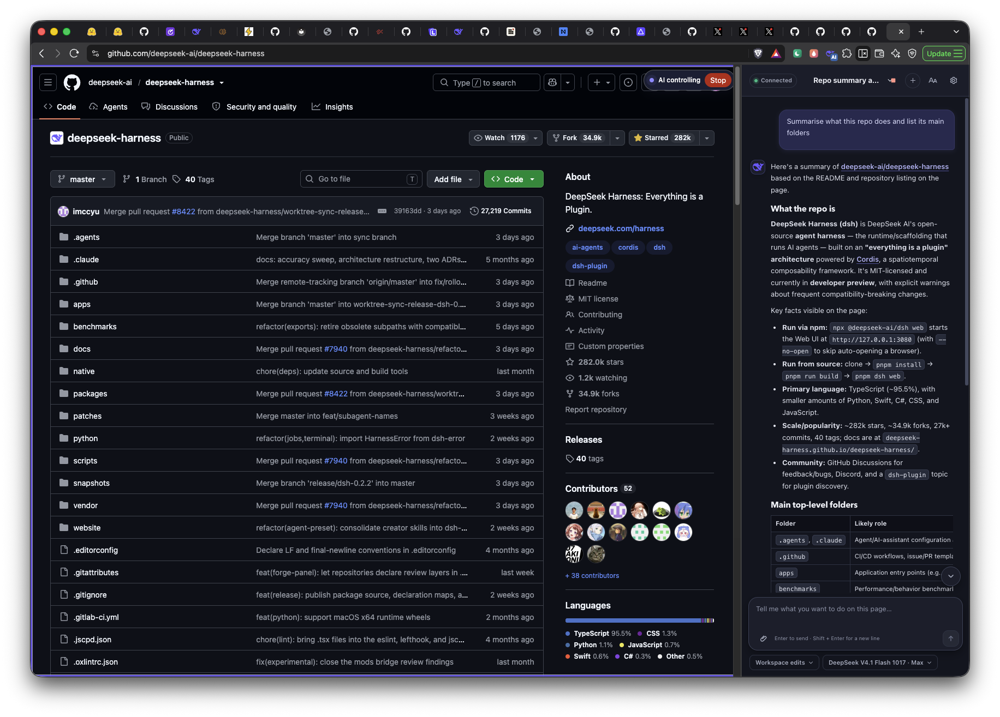

# dsh Browser Agent

[](https://github.com/natgurlain/dsh-browser-agent/releases)
[](https://www.npmjs.com/package/@natgurlain/dsh-bridge-browser)
[](LICENSE)


[](docs/dsh-matrix.md)

[English](README.md) | **中文**

让 [DeepSeek Harness](https://github.com/deepseek-ai/deepseek-harness)（DSH）在你日常使用的浏览器里工作。智能体读取你正在看的页面，点击、输入、导航、管理标签页，用的是你自己的 Chrome、Brave 或 Firefox（其他 Chromium 浏览器应当也可用），保留你的登录态和 Cookie；你在侧边栏里查看并批准它的每一步。



> 基于 Yuxiang Lin 及贡献者的 [dsh-browser](https://github.com/omdsh-dev/dsh-browser)（MIT 许可）。见 [NOTICE](NOTICE)。

**目录：** [这是什么](#这是什么) · [为什么用它](#为什么用它) · [快速开始](#快速开始) · [从发布版本安装](#从发布版本安装) · [核心能力](#核心能力) · [详细安装与使用](#详细安装与使用) · [故障排查](#故障排查) · [开发](#开发) · [安全](#安全)

## 这是什么

本仓库包含两个配套的部分：

- **浏览器扩展**（Manifest V3），带一个用于对话的侧边栏。它把页面转换成结构化文本和带编号的可交互元素清单，并在真实标签页里执行智能体的操作。
- **DSH 插件**（“桥”），为 DSH 提供 `browser_*` 工具，并通过本机的、经过认证的连接与扩展通信。

它可以配合 DeepSeek Harness 桌面应用或 `dsh web` 使用，使用你在其中配置的模型，也可以通过 MCP 由 Claude Code、Cursor 或 Codex 驱动。

## 为什么用它

- **用你真实的浏览器。** 不需要单独的配置文件、重新登录或无头窗口：智能体就在你眼前的标签页里工作。
- **始终由你掌控。** 会改变内容的操作先弹出审批卡，写明将要点击、输入或打开什么。你可以暂停、接管页面，或按“停止”一次切断一切。
- **为不可信页面而设计。** 智能体读过网页之后，向其他站点、剪贴板或文件发送数据都要先询问，并且该会话的 shell 和文件工具会被关闭，试图劫持智能体的页面无处外传数据。银行、密码管理和云控制台类站点默认只读。
- **上锁的入口。** 扩展与 DSH 每次连接都用一个不经网络传输的共享密钥互相证明身份；本机上的其他程序和其他扩展无法连接。
- **全程留痕。** 每个操作、审批和停止都写入可导出的防篡改审计日志。
- **不止点击。** 表格导出 CSV、PDF、下载、文件上传、悬停与拖拽、对话框、多标签页并行阅读、页面监视，以及可重放或定时运行的已保存工作流。
- **用着舒服。** 浅色和深色主题、中英文界面、可调字号。

## 快速开始

需要 DeepSeek Harness（桌面应用，或 `dsh` 0.2.2-rc.1 至 rc.3）和一个 Chromium 浏览器或 Firefox。

```sh
git clone https://github.com/natgurlain/dsh-browser-agent.git
cd dsh-browser-agent
./scripts/install.sh
```

安装器会构建扩展和插件，把插件注册到 DeepSeek Harness 桌面应用和 `web` profile，并打开浏览器的扩展管理页。它使用机器上已有的 Node.js 24.9+ 和 pnpm（包括桌面应用自带的），找不到时会告诉你该安装什么。然后：

1. 在扩展管理页开启**开发者模式**，点击**加载已解压的扩展程序**，选择 `~/.dsh/browser-extension`（仅首次；更新后点击**重新加载**）。
2. 打开 DeepSeek Harness（如果正在运行，请重启）。
3. 打开任意网页，点击工具栏中的鲸鱼图标，等待显示**已连接**。

无需填写地址或密码：安装器已把扩展在本机发现并认证 DSH 所需的信息准备好。

> [!NOTE]
> 状态：早期阶段。macOS 和 Linux 的安装经常运行；Windows 安装器（`scripts/install.ps1`）已提供，但尚未在 Windows 机器上运行过。支持的 DSH 版本见 [docs/dsh-matrix.md](docs/dsh-matrix.md)；在 0.2.2-rc.1 上，失败后“继续”和删除会话时等待 worktree 清理这两项不可用。

## 从发布版本安装

安装器会安装桥插件和 Chrome 扩展。它下载一个带标签的发布版本，把每个下载的文件与该版本的 `SHA256SUMS` 逐一比对，校验通过后才解压并从源码构建。校验值不符、缺少 `SHA256SUMS` 或下载不完整时，安装会在解压或执行任何内容之前停止。

macOS 与 Linux。先下载安装器，用已发布的校验值核对，再运行：

```sh
tag=v0.2.1
base=https://github.com/natgurlain/dsh-browser-agent/releases/download/$tag
curl --proto '=https' --tlsv1.2 -fsSL -O "$base/install.sh" -O "$base/SHA256SUMS"
grep ' install.sh$' SHA256SUMS | sha256sum -c -    # macOS: shasum -a 256 -c -
bash install.sh --release "$tag"
```

Windows（PowerShell；`install.ps1` 的发布版本路径尚未在 Windows 机器上运行过）：

```powershell
$tag = 'v0.2.1'
$base = "https://github.com/natgurlain/dsh-browser-agent/releases/download/$tag"
irm "$base/install.ps1" -OutFile install.ps1; irm "$base/SHA256SUMS" -OutFile SHA256SUMS
$want = (Select-String -Path SHA256SUMS -Pattern ' install\.ps1$').Line.Split(' ')[0]
if ((Get-FileHash install.ps1 -Algorithm SHA256).Hash -ne $want) { throw 'install.ps1 does not match SHA256SUMS' }
powershell -NoProfile -ExecutionPolicy Bypass -File .\install.ps1 --release $tag
```

同样的校验值也印在每个[发布版本](https://github.com/natgurlain/dsh-browser-agent/releases)的说明里。下面的简短形式不会先核对安装脚本本身；安装器下载的内容仍会被校验：

```sh
curl --proto '=https' --tlsv1.2 -fsSL https://github.com/natgurlain/dsh-browser-agent/releases/download/v0.2.1/install.sh | bash -s -- --release v0.2.1
```

`--release latest` 安装最新的发布版本，而不是指定的版本。`SHA256SUMS` 与文件来自同一个发布版本，因此它能发现损坏、截断或被替换的下载，但不能防范接管了仓库或发布流程的人所发布的版本；见 [RELEASING.md](RELEASING.md#what-verification-covers)。

安装器打开 `chrome://extensions` 后，请按提示加载或重新加载 **dsh 浏览器助手**。如果 dsh 已经在运行，安装完成后请重启。前置要求、启动命令、更新方式和开发者安装详见[详细安装与使用](#详细安装与使用)。

> [!IMPORTANT]
> npm 上未加 scope 的 [`dsh-browser`](https://www.npmjs.com/package/dsh-browser) 包属于另一个项目，与本仓库无关。本项目目前没有发布 npm 包，请使用上方安装器。

### 只装插件，不用安装器

如果你想用 DSH 自己的插件命令安装，每个发布版本也单独附带了插件包和扩展构建：

```sh
dsh plugin --profile web add https://github.com/natgurlain/dsh-browser-agent/releases/download/v0.2.1/dsh-bridge-browser-v0.2.1.tgz
```

然后从同一个[发布页](https://github.com/natgurlain/dsh-browser-agent/releases)下载 `dsh-browser-chrome-v0.2.1.zip`（或 Firefox 的 zip），解压后在浏览器的扩展管理页用**加载已解压的扩展程序**加载，再打开侧边栏。这样安装的扩展还没有 token：它会显示一个短码，把它输入 DSH 中出现的卡片即可连接。如果使用 DeepSeek Harness 桌面应用，请使用上面的安装器：它会替你把插件注册到应用中。

## 核心能力

| 能力 | 工具 | 说明 |
|---|---|---|
| 读取页面 | `browser_snapshot` | 结构化文本快照：标题/URL/正文/编号交互清单/表单字段（敏感值掩码）；`delta: true` 只返回变化，`frame` 单读一个 iframe，`query` 按文本/选择器/角色定位任意元素并给出选择器 |
| 点击 | `browser_click` | 按编号或选择器点击、双击；支持鼠标按键和修饰键 |
| 文本 | `browser_type` | 输入文本（React/Vue 受控组件兼容），`replace` 清空重填；`mode` 可选插入或逐键输入（自动补全类字段） |
| 按键 | `browser_press` | 单键或组合键（`modifiers`），`action: down/up` 跨调用按住，`repeat` 重复 |
| 滚动 | `browser_scroll` | 向上、向下滚动页面或指定 iframe，或滚动到顶部、底部 |
| 剪贴板 | `browser_clipboard` | `write` 写入系统剪贴板（文本/HTML）；`paste` 以粘贴事件或真实快捷键粘贴到页面 |
| 文件 | `browser_upload` | 把本机文件附加到 `input[type=file]`（Chrome） |
| 页面导航 | `browser_navigate` / `browser_open_tab` / `browser_back` / `browser_forward` / `browser_reload` | 受控标签页内导航，或新开标签页并跟随（`active:false` 时保持当前页在前台） |
| 列出标签页 | `browser_list_tabs` | 列出可访问标签页的稳定 ID、标题、URL、窗口/顺序以及活动/受控状态 |
| 跟随标签页 | `browser_follow_tab` | 将后续浏览器工具绑定到 `browser_list_tabs` 返回的标签页；默认不激活，`activate: true` 才切到前台 |
| 关闭标签页 | `browser_close_tab` | 关闭 `browser_list_tabs` 返回的标签页 |
| 悬停 / 拖拽 | `browser_hover` / `browser_drag` | 用真实指针悬停元素（打开悬停菜单）；拖到另一元素或按偏移拖动，可拖拽源使用 HTML5 拖放事件 |
| 对话框 | `browser_dialog` | 回应 alert/confirm/prompt/离开页面对话框；被对话框阻塞的调用会立即以 `dialog open: …` 失败（Chrome） |
| 下载 | `browser_downloads` | 列出最近下载或等待下载完成，返回本地文件路径；首次使用时请求可选的 `downloads` 权限 |
| PDF | `browser_save_pdf` / `browser_pdf_text` | 把标签页保存为 PDF 到代理工作区（Chrome）；提取标签页中 PDF 的文本 |
| 选择选项 | `browser_select` | 按值、标签或序号在 `<select>`、ARIA listbox 或 combobox 中选择选项 |
| 提取表格 | `browser_extract` | 从表格或重复元素（schema）提取行，可跨页；`saveTo` 把 CSV/JSON 写入会话工作区 |
| 批量操作 | `browser_run` | 按顺序执行最多 25 个浏览器操作，只需一张批准卡片；遇到第一个错误或 `expect` 失败即停止 |
| 监视页面 | `browser_watch` / `browser_watches` | 当选择器或文本出现/消失、URL 匹配或出现某个请求时唤醒本会话；列出或取消监视器。需先在设置中开启，每个监视器都需批准 |
| 批量阅读 | `browser_fanout` | 最多 8 个子代理各用一个后台标签页并行阅读（默认只读，`allowActions` 才可操作），返回结构化答案 |
| 委派 | `delegate_browser_task` | 普通 DSH 会话把页面工作交给浏览器子代理，页面快照不会占满该会话 |
| 已保存工作流 | `browser_workflow_list` / `browser_workflow_run` | 列出并重放之前保存的工作流（见[学习功能](#学习功能实验性默认全部关闭)） |
| 读取区域 | `browser_get_text` | 懒加载内容 / 局部文本 |
| 等待稳定 | `browser_wait` | 页面加载与渲染稳定检测 |
| 发送图片 | `session.prompt` / `session.attachment` | 按宿主能力启用图片草稿、纯图片消息和持久历史预览 |
| 引用选中内容 | 侧栏输入框 | 在页面里划选的文字会出现在输入框，随下一条消息一起发送，并带上来源与不可信内容边界 |
| 继续生成 | 侧栏 | 请求失败后，点击出现的“继续生成”按钮继续对话 |

点击、文本输入和滚动操作在指定文档中执行，支持跨域 iframe。Chrome 通过调试器执行原生键盘事件、光标位置插入、系统粘贴和文件上传。截图要求受控标签页处于活动状态且窗口聚焦，可以使用 `browser_follow_tab { activate: true }` 将页面切到前台。

每次点击前都会对目标中心做命中测试；被其他元素遮挡的目标会以 `covered by <元素>` 拒绝，而不是点到上层元素。`browser_click { trusted: true }` 使用真实鼠标输入（Chrome）；对自定义元素的普通点击若没有任何可见效果，会自动用真实输入重试一次。侧栏中的**停止按钮**（或 Ctrl+Shift+K / ⌘⇧K；Firefox 为 Alt+Shift+K；可在浏览器扩展快捷键页面改绑）会取消待确认请求和正在执行的操作、撤销会话信任与开发者工具授权、关闭不受限访问、断开调试器，并在你点击「重新连接」前保持断开。代理控制的标签页显示 **AI** 徽标。

### 可见性与控制

- **批准卡片**在操作发生前显示将要点击、输入或打开的确切内容，每张卡片只绑定这一个操作。
- **暂停 / 接管。** “此步后暂停”让当前操作完成，并在你继续前挂起下一步。“接管”暂停代理，让你自己操作页面；继续后交还控制权，模型会被告知发生了什么变化。
- **代理叠加层。** 代理操作前，幽灵光标和轮廓会标出每个目标；受控标签页带有彩色边框和停止按钮（可在设置中关闭叠加层）。
- **步骤时间线与审计日志。** 侧栏列出一次运行的每个步骤。每个操作、批准和紧急停止都会写入 `~/.dsh/browser-audit/` 下防篡改的审计日志，可在设置中导出。
- **站点规则。** 在设置中把站点设为禁止、只读、总是询问或信任。代理读取不可信内容后，向其他站点写入需要重新批准（污染规则）。你自己的本地页面和你设为信任的站点不算不可信内容，见[安全](#安全)。
- **严格模式**（Chrome）。对你列出的站点或某个代理会话，页面发出的写请求会在网络层挂起，直到你批准。

### 自动审核（由本对话的模型决定审批）

默认关闭，按对话开启。在输入框下方，**审批：询问 · 自动** 可把当前对话切换为自动审核；首次开启时会显示一段说明，介绍它的作用和代价。开启期间，面板显示“自动审核已开启 · 剩余 N 分钟”和 **关闭** 按钮。

- **它做什么。** 对于普通审批卡片（点击、在普通字段中输入、选择选项、同站跳转），扩展先按一组固定规则检查。符合条件时，DSH 会询问本对话自己的模型：这个操作是否符合您在自己消息中的要求。*允许* 等同于您点击了“允许一次”（执行前会再次检查页面，元素变化则取消）；*询问*、无效回答、出错或 9 秒内未回答，都会显示常规卡片，并附一行“自动审核请您决定：……”。时间线把自动批准的步骤标为 **自动**，并附模型的一句理由；审计日志记录每次审核（决定、风险、理由、模型、耗时、卡片绑定）。
- **它永远不决定的。** 所有保护数据的卡片仍会询问：对话读取网页后携带数据的跳转、跨站输入、剪贴板与文件写入；携带密钥的网址；站点规则（询问、只读、阻止）；严格模式；逐次确认的卡片；密码、支付和一次性验证码字段；开发者工具和页面 JavaScript；上传与下载；对话框；浏览器权限；`browser_run` 程序与批量步骤；标签页编队；页面监视器；新标签页、后退/前进和刷新；跳转到其他站点；以及来自 MCP 客户端的对话。提交、发送、保存或删除只有在您的消息明确要求时才会被批准；支付、购买、账户与安全设置、凭证和授权始终询问。页面文本和代理读到的内容都作为不可信数据交给模型，永远不能授予任何权限。
- **限制。** 自动审核在 60 分钟后、您按下停止、接管页面或删除对话时结束。自您上一条消息起批准 25 个操作后，会弹出卡片询问是否继续；达到 100 个后暂停，直到您再次发送消息。新消息会取消正在进行的审核。
- **代价与隐私。** 每个被审核的操作都会通过 DSH 向本对话的模型额外发送一次请求，使用您的账户。发送内容包括：您在本对话中的消息（从网页附加的文本不包含在内）、操作本身、元素的标签和所在区域、页面标题和地址（不含查询参数和片段），以及普通字段中将要输入的文本。不发送页面内容或快照。
- **它做不到的。** 模型可能判断错误，代理也可能把步骤描述得看似无害。真正防止数据外泄的是上述固定规则，而不是模型：免模型检查会在审核模型“总是允许”的情况下运行所有提示注入场景，强制卡片依然拦下每一个。如果某个元素外表普通、页面脚本却会删除或发送内容，点击它仍可能被批准；如果您担心某个站点，请在设置中把该站点设为“询问”，或保持“审批：询问”。
- **彻底关闭。** 设置 → 自动化 → *提供自动审核* 可隐藏该控件。管理员可设置托管策略键 `disableAutoReview`；桥接插件配置 `autoReview: false` 会让主机不再提供该功能。设计与威胁模型见 [docs/auto-review-design.md](docs/auto-review-design.md)。

### 在 Claude Code、Cursor 或 Codex 中使用浏览器（MCP）

在 `bridge-browser` 插件配置中设置 `mcp: { enabled: true }`，然后在 MCP 客户端中注册 stdio shim `packages/browser/mcp-server/bin/dsh-browser-mcp.mjs`，例如 `claude mcp add dsh-browser -- node /abs/path/to/dsh-browser-mcp.mjs`。每个 MCP 调用都经过与 DSH 自身会话相同的批准卡片、站点策略、污染规则、紧急停止和审计日志，每张卡片都会标明发出请求的 MCP 客户端。Cursor 和 Codex 的配置示例见 [packages/browser/mcp-server/README.md](packages/browser/mcp-server/README.md)。

### 学习功能（实验性，默认全部关闭）

在侧栏 **设置 → 学习功能（实验性）** 中开启。每个重放或学到的操作仍然经过暂停闸门、站点策略、污染规则、紧急停止、批准卡片和审计日志。

- **保存为工作流。** 开启“记录运行”后，代理每个成功的步骤会和重新定位该元素的方式（角色、可访问名称、文本，以及 CSS 后备）一起保存在内存中。**保存为工作流** 会把它们写入会话工作区的 `browser-workflows/<名称>.workflow.json`，由你选择哪些输入值成为参数。输入到敏感字段的值从不存储，而是作为必填参数。每个保存的工作流也会作为 DSH 技能提供。
  - `browser_workflow_run` 重放工作流，每一步都重新查找元素；元素不存在或有歧义时停下，把这一步交给模型。
  - 面板可以把工作流定时在它所属的会话中运行，最短每分钟一次。批准卡片照常询问，无人回应时默认拒绝。含敏感输入的工作流不能定时。

**侧栏关闭时的连接。** 最后一个面板关闭后，扩展会在最近一次工具调用或批准之后再保持连接 5 分钟，然后断开并让后台 worker 休眠。有三项需手动开启的功能本来就是无人值守运行的，只要其中之一在使用，连接就会保持并自动恢复：仍然有效的页面监视器、从本浏览器创建的定时工作流，以及 MCP 端点（`mcp.enabled`）。后两项由 dsh 在连接时告知扩展；扩展会记住这一点，因此浏览器重启后无需打开面板也会重新连接到同一地址。扩展不会自行扫描寻找 dsh；dsh 无法连接时重试间隔逐步拉长（30 秒起，每次翻倍，最长 5 分钟）。设置页会显示是什么让浏览器保持连接。停止按钮会结束这一切：在你点击“重新连接”之前不会再连接。策略强制的批准卡片仍然只能在面板中回答，无人值守的运行遇到它时默认拒绝。
- **观察我。** 观察期间记录你在标签页上的点击和输入，从不记录密码，敏感字段会被遮盖。在表格或列表行上重复两次后，面板会提供 **按同样方式完成剩余 N 项**，它作为一个 `browser_run` 程序运行，只需批准一张卡片。
- **站点驱动**（仅 Chrome，需允许开发者工具）。对你列出的站点，代理操作背后的同源请求会被建议为一个类型化工具（`browser_site_<主机>_<名称>`）。经你批准才会保存；Cookie、令牌和敏感字段从不存储，令牌每次都从页面读取。每次使用都会在单独的卡片上显示确切请求；驱动失败时代理改用页面界面。驱动可以导出和导入为 JSON。
- **失败样例。** 步骤失败时，在会话工作区的 `browser-fixtures/` 下保存脱敏的页面副本（敏感值已遮盖，脚本已移除）和预期操作。被阻止或未共享的页面会跳过，每次保存都会记入审计日志。`node benchmark/import-fixtures.mjs <目录>` 可把这些文件转为基准任务文件。`benchmark/online-mind2web/` 在运行时加载 Online-Mind2Web 子集，并用其他地方产生的结果生成静态排行榜。两者都还没有 runner：`benchmark/run.mjs` 只运行内置任务（见 [benchmark/README.md](benchmark/README.md)）。

## 详细安装与使用

前置要求：Node.js `>=24.9.0`、Corepack/pnpm，以及 Chrome 125+ 或 Firefox 140+。Windows 还需要系统自带的 Windows PowerShell 5.1，或 PowerShell 7+。

### 安装或更新

运行[发布版本安装命令](#从发布版本安装)，或在 checkout 中运行 `./scripts/install.sh` 即可安装。在 macOS 和 Linux 上只需一条命令，其余由安装器完成：

- **DeepSeek Harness 桌面应用。** 检测到应用时（macOS 的 `/Applications` 或 `~/Applications`；其他位置用 `DSH_DESKTOP_APP=<路径>` 指定，`DSH_DESKTOP_APP=none` 则跳过），除了 `web` profile，还会通过应用自带的 CLI 把桥插件注册到应用专用的 `desktop` profile。安装后请退出并重新打开应用。如果应用的 DSH 版本不在插件支持的范围内，安装器会明确说明，只注册 `web` profile，并提示先更新应用再重新运行；它不会绕过版本检查。
- **Node.js 与 pnpm。** PATH 上的 `node` 不存在或低于 24.9.0 时，安装器使用本机已经安装的版本：先是应用自带的 Node，然后是 asdf、nvm、fnm、volta 或 mise 中已有的合适版本。PATH 上的 `pnpm` 无法运行时，依次使用应用自带的 pnpm、Corepack、`npx`。安装器不会替你安装任何东西；找不到合适的 Node 时，它会给出本机已有工具对应的安装命令。
- **浏览器。** 安装器会打开你已安装的 Chromium 浏览器（Chrome、Chromium、Brave、Edge、Vivaldi 或 Arc；默认浏览器在其中时优先使用）的扩展管理页，提示文字也使用该浏览器的名称。首次安装时加载 `~/.dsh/browser-extension` 目录；更新后点击**重新加载**。

安装结束时的摘要会列出桥插件注册到了哪里、跳过了什么。Windows 的 `install.ps1` 只注册 `web` profile，也只检测 Chrome 或 Chromium。如果 dsh 已在运行，请重启。

更新时，在侧栏打开**设置 → 软件更新**。检查会把当前版本与 GitHub 上的最新发布版本比较，并给出一条用本机已有的安装器安装该版本的命令，例如：

```sh
DSH_HOME="$HOME/.dsh" bash "$HOME/.dsh/dsh-browser/scripts/install.sh" --release v0.2.1
```

安装器选项：

| 选项 | 环境变量 | 作用 |
| --- | --- | --- |
| `--release latest` 或 `--release vX.Y.Z` | `DSH_BROWSER_VERSION` | 下载该发布版本并用它的 `SHA256SUMS` 校验。不在 checkout 中运行时，这是默认行为。 |
| `--unverified-branch <name>` | `DSH_BROWSER_UNVERIFIED_BRANCH` | 仅用于开发：安装分支归档。分支没有校验值，内容不会被校验。 |
| | `DSH_BROWSER_GITHUB_TOKEN` | 私有仓库使用的 token。只会发送到 `api.github.com`，不会被打印。未设置时安装器会改用已登录的 `gh`。 |
| | `DSH_BROWSER_NO_LAUNCH=1` | 不打开浏览器，也不改动剪贴板。 |
| | `DSH_DESKTOP_APP=<路径>` 或 `none` | DeepSeek Harness 桌面应用的位置；`none` 表示不处理桌面应用（适用于 `install.sh` 和卸载器）。 |
| `--lang en` 或 `--lang zh` | `DSH_BROWSER_LANG` | 安装器和卸载器的输出语言。每次运行只输出一种语言：默认英文，系统语言为中文时输出中文。 |

如需从源码 checkout 安装（不下载任何文件）：

```sh
git clone https://github.com/natgurlain/dsh-browser-agent.git
cd dsh-browser-agent
./scripts/install.sh
```

Windows 请在 checkout 中运行 `.\scripts\install.ps1`。拉取或切换版本后，请重新运行安装器并重新加载扩展。

### 卸载

在扩展的**设置 → 卸载 dsh-browser**中复制命令，然后在终端运行。

记录了安装位置的安装由本机已有的卸载器移除。否则，命令会获取与扩展自身版本一同发布的卸载器；它从该发布版本下载 `uninstall.mjs`，只有在其 SHA-256 与 `SHA256SUMS` 一致后才运行。macOS 或 Linux：

```sh
curl --proto '=https' --tlsv1.2 -fsSL https://github.com/natgurlain/dsh-browser-agent/releases/download/v0.2.1/uninstall.sh | bash -s -- --release v0.2.1
```

Windows 请运行：

```powershell
& { $ErrorActionPreference = 'Stop'; $d=New-Item -ItemType Directory -Path (Join-Path ([IO.Path]::GetTempPath()) ('dsh-browser-uninstall.'+[Guid]::NewGuid().ToString('N'))); try { $s=Join-Path $d.FullName 'uninstall.ps1'; Invoke-WebRequest -UseBasicParsing https://github.com/natgurlain/dsh-browser-agent/releases/download/v0.2.1/uninstall.ps1 -OutFile $s; powershell -NoProfile -ExecutionPolicy Bypass -File $s --release v0.2.1 } finally { Remove-Item -LiteralPath $d.FullName -Recurse -Force } }
```

在源码目录中运行 `bash scripts/uninstall.sh` 或 `.\scripts\uninstall.ps1`。

卸载器也会通过应用自带的 CLI 从桌面应用的 `desktop` profile 中移除桥插件（应用不在 `/Applications` 或 `~/Applications` 时，用 `--desktop-app <路径>` 或 `DSH_DESKTOP_APP` 指定）。找不到应用时，该注册及其共用的文件会保留，卸载器会给出说明。

### Firefox 源码构建

Firefox 使用独立的 MV3 manifest、事件页后台和 Sidebar。在 checkout 中构建后，打开 `about:debugging#/runtime/this-firefox`，选择「临时载入附加组件」，再选取 `extensions/dsh-browser/dist-firefox/manifest.json`：

```sh
pnpm install
pnpm --filter dsh-browser-extension run build:firefox
```

桥地址仍会自动探测。Firefox 附加组件不由安装器安装：打开侧边栏后会显示一个配对码，把它输入 DSH 中出现的卡片即可（见 [docs/store/README.md](docs/store/README.md#pairing-a-store-installed-extension)）。把 `~/.dsh/ext-bridge-token` 中的桥接 token 粘贴到扩展设置中仍可作为备用方式。签名发布时可直接使用同一份 `dist-firefox/` 产物。

### 启动与使用

使用 DeepSeek Harness 桌面应用时，直接打开应用即可（安装后请重启应用）。下面的 `pnpm start` 和 `dsh web` 启动的是独立的 `web` profile，不包含桌面应用里配置的模型。

启动托管安装：

```sh
cd ~/.dsh/dsh-browser && pnpm start
```

使用源码 checkout 时，请在仓库根目录运行 `pnpm start`。受支持的精确公开版本为：

```sh
npx @deepseek-ai/dsh@0.2.2-rc.2 web
```

Chrome 本机使用无需配置：安装器会把桥接 token 放到已安装的扩展目录中，插件会让这份副本保持最新。Firefox 通过配对连接（侧边栏显示一个短码，输入到 DSH 中），或填写上述本地桥 token。打开页面，点击 DeepSeek 鲸鱼图标，等待侧边栏显示**已连接**。已有 HTTP(S) 标签页会在第一次操作时自动加载。在浏览器受保护页面和扩展商店中，模型可以读取标签页元数据，并通过浏览器级能力导航到 HTTP(S)、后退、前进和刷新，但不能读取或操作受保护页面的 DOM。

## 故障排查

**侧边栏一直显示「未连接」**

- 确认 DSH 正在运行。安装或更新后，重启 DSH 并重新打开侧栏。
- 打开**设置 → 自动检测**，选择需要连接的 DSH 实例。
- Firefox 或从商店安装的版本会在侧边栏显示配对码：把它输入 DSH 中出现的卡片（或运行 `/browser-pair <配对码>`）。备用方式：在设置中填写 `~/.dsh/ext-bridge-token` 中的 token。
- 连接远程 DSH 时，在设置中填写服务器地址和对应的桥接 token。
- 如果插件配置固定了自己的 `token`，请把该 token 粘贴到扩展设置中；已安装扩展里的副本只跟随 `~/.dsh/ext-bridge-token`。
- 更新后请同时重新加载扩展并重启 DSH：桥接握手带有版本号，旧版扩展或插件会被拒绝，并以「protocol version mismatch」关闭连接。

### 桥接安全

- 所有客户端（包括本机回环）都通过桥接令牌完成双向 HMAC 质询-应答（握手 v3）；令牌本身不经过网络，扩展会拒绝无法反向证明令牌的桥接。
- 两侧证明都绑定扩展实际拨号的地址和端口，桥接会与它接受的套接字核对，因此从其他端口转发握手的本地进程无法完成握手。握手之后每一帧（双向）都带有按连接派生的密钥和严格递增序号的 MAC；未封装、重放、乱序或篡改的帧会直接断开连接。帧只做认证、不加密。经端口转发（Docker `-p`、SSH 隧道）以不同端口访问桥接时会被拒绝，除非在插件配置 `forwardedPorts` 中列出该回环端口**并且**设置 `allowForwardedPorts: true`。在转发端口上监听的程序位于中间，可以读取每一帧（会话记录、页面内容），因此只列出你控制的转发：在列出的端口空闲时绑定它的本地进程可以借它中转。双方声明的能力（caps）也绑定在两侧证明中（协议 v4），即使是受信任的转发也无法开启开发者工具组或修改快照上限。桥接 URL 中的 DNS 名称仅在桥接监听回环地址时被接受；局域网或远程桥接必须用 IP 地址连接。
- 插件配置中固定的 `token` 至少 32 个可打印字符且具备足够熵（例如 `openssl rand -hex 32`），否则插件启动失败，因为截获的握手可让本地观察者离线猜测弱 token。
- Chrome 连接只接受 manifest key 固定的扩展 ID（`klmdgljhcjbbpjcplbanjeclilghnaoh`）。其他构建（Web Store 或 Brave 安装的版本）在用户把其侧边栏显示的配对码输入 DSH 后即被接受，其 ID 记录在 `~/.dsh/browser-paired-extensions.json`；bridge-browser 插件配置中的 `allowedChromeExtensionIds` 仍可用于不经配对直接允许某个构建。用 `pnpm --filter dsh-browser-extension run build:store` 构建商店包，该命令会去掉商店不接受的 `key`。
- 桥只转发扩展实际用到的 Host 方法。扩展只能在桥接自己创建的会话中发送提示、修改设置、注入页面快照或删除会话：`session.create` 总是新建会话（忽略扩展传入的 `sessionId`、`cwd`、`workspaceId`），归属记录在 `~/.dsh/browser-bridge-sessions.json` 和桥接工作区目录中。桌面端和 CLI 会话不出现在侧边栏的历史列表中；它们驱动浏览器时，仍可查看历史（用于审批）和停止，但不能从浏览器发送提示。子代理会话始终不可访问。
- 新的浏览器会话即使宿主默认是完全访问，也会以受限预设启动；切换到完全访问预设，以及在当前运行完全访问预设的会话中发送提示、注入或执行命令都会被拒绝。只有宿主预设表中沙箱为 `read-only` 或 `workspace-write` 的预设（或列在 `safePermissionPresets` 中的预设）被视为受限；未知预设、改名的完全访问预设以及 `custom` 都会被拒绝，`/permission` 只接受严格的 `/permission <preset>` 形式。在插件配置中设置 `allowDangerFullAccess: true` 可解除这些限制。
- 中转站的已存密钥只会发送到保存时的地址：用不同地址测试模型列表需要重新输入密钥；修改中转站地址但未重新输入密钥时，已存密钥会被清除。

## 开发

面向贡献者的构建、测试与发布说明见 [docs/development.zh.md](docs/development.zh.md)：工作区命令、一条命令运行全部检查的本地 gate（`pnpm gate`），以及 DSH 兼容性矩阵。发布流程见 [RELEASING.md](RELEASING.md)。

## 安全

- 助手读取的页面文字和你发送的附件会交给当前选择的模型。
- 页面内容共享可以选择**自动共享**（默认）、**每次询问**或**关闭**。
- 文本快照会遮盖密码和卡号值；截图保留可见像素，不会遮盖字段。
- 页面操作默认需要审批。你可以信任指定网站，或开启**允许模型完全控制浏览器**。开发者工具需要单独授权。
- 切换标签页后，助手会询问接下来操作哪个页面。
- **不可信的页面内容。** 对话读取过网页后，高风险操作会先询问（向其他站点输入或粘贴、写剪贴板和文件、打开带数据的其他站点 URL），即使已信任站点或开启完全控制；DSH 一侧该对话的命令行和文件写入工具也会停用。侧栏用一行横幅列出涉及的站点，点**清除**解除限制。
- **不算不可信的两种情况**（**设置 → 权限与安全 → 访问**中各有一个开关，默认开启；托管策略可用 `disableLocalTaintExemption`、`disableTrustedTaintExemption` 强制关闭，DSH 宿主可用 `honorTaintExemptions: false` 关闭，本地页面还受 `devLoop.trustLoopback: false` 影响）：
  - *你的本地页面*：你确认属于自己的本地地址（`localhost`、`*.localhost`、`127.0.0.1`、`[::1]`，含端口）。为开发循环关联标签页、在横幅上回答“把 localhost:3000 的页面当作你自己的页面？”，或在设置中添加，都会把地址加入该列表。主机名按精确匹配，`localhost.evil.com`、`127.0.0.1.nip.io` 是普通网页。DSH 宿主自身的网页界面永不豁免。
  - *你信任的站点*（仅限 https）：通过横幅上的**信任 <站点>**添加的站点（设置中单独列出，不改变任何审批卡片）、设为**信任**的站点规则，以及**永久免确认域名**。此功能出现之前就有的信任规则或免确认域名，需在设置中确认一次（“保留”）后才算。同一站点上更严格的规则（禁止、只读、每次询问、内置保护）始终优先。完全控制、审批卡片上的“本次会话信任”以及管理员规则都不算。

  只有读取的内容（含被读取的每个 iframe）全部豁免时，对话才不受限；截图、PDF、开发者工具输出和带有控制台错误的结果总会限制对话。读到其他页面后照常受限，此前读过的豁免页面也计入来源（通过**信任**解除限制之后、以及由该对话分叉出的对话同样如此）。这两项例外不改变数据可以去哪里：受限的对话向本地地址或受信任站点发送数据仍需询问。
- **仍然存在的风险。** 显示非你本人内容的本地页面（本地邮件或订阅阅读器、代理、下载文件的预览、渲染用户内容的开发服务器），以及显示他人内容的受信任站点（评论、工单、邮件），都可能带有针对助手的指令，而只读过这类页面的对话不受限。如有这种情况，请关闭对应开关。
